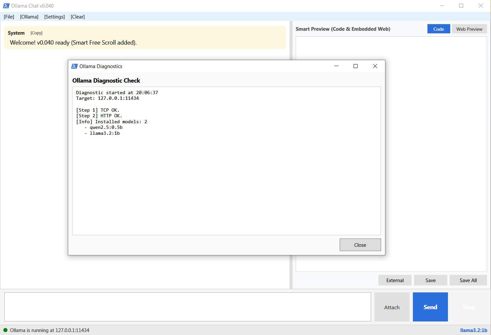

# Snw Ollama GUI Chat (PowerShell + WPF)

> A dependency-free Windows desktop chat client for local **Ollama** models,
> with streaming responses, Markdown/code rendering, file attachments,
> RTL support, dark mode, and a smart preview pane — all in a single
> PowerShell script.


---

## 📑 Table of Contents

- [Overview](#-overview)
- [Features](#-features)
- [Requirements](#-requirements)
- [Installation](#-installation)
- [Quick Start](#-quick-start)
- [Using the App](#-using-the-app)
  - [Chat Area](#chat-area)
  - [Attachments](#attachments)
  - [Preview Pane](#preview-pane)
  - [Keyboard Shortcuts](#keyboard-shortcuts)
- [Configuration](#️-configuration)
  - [Settings Dialog](#settings-dialog)
  - [Settings File](#settings-file)
  - [Sampling & Speed](#sampling--speed)
- [Menu Reference](#-menu-reference)
- [Diagnostics](#-diagnostics)
- [Data & Files](#-data--files)
- [Architecture](#️-architecture)
- [Troubleshooting](#-troubleshooting)
- [Known Limitations](#-known-limitations)
- [Roadmap](#️-roadmap)
- [License](#-license)

---

## 🧭 Overview

**SnwOllamaGUI Chat** is a lightweight desktop chat client for [Ollama](https://ollama.com),
built entirely with **PowerShell 5.1 + WPF**. It requires **no Python, no Node.js,
no package manager, and no installer** — just a Windows machine, PowerShell, and a
running Ollama server.

It was designed for bilingual (Arabic/English) users and for developers who want a
fast, local, privacy-respecting chat UI that can render code, tables, and files
without leaving the desktop.


---

## ✨ Features

### 💬 Chat
- **Streaming responses** — tokens appear as they are generated; the UI never freezes.
- **Stop generation** at any time; the partial reply is kept and marked `[Stopped by user]`.
- **Regenerate** any assistant reply with one click.
- **Edit & resend** any previous user message (truncates history from that point).
- **Copy** any message (or copy individual code blocks).
- **Smart free scroll** — the chat does not auto-scroll while you are reading older
  messages; it resumes when you send a new prompt or return to the bottom.
- **Session stats** — input/output token counts, tokens/second, and context
  window usage displayed in the status bar.

### 🎨 Rendering
- **Inline Markdown** — `**bold**`, `*italic*`, and `` `inline code` `` are rendered
  inside each bubble via a `RichTextBox`.
- **Fenced code blocks** become bordered cards with a language label and a
  per-block **Copy** button.
- **Markdown tables** are rendered as either:
  - **FlowDocument tables** (clean, integrated look), or
  - **interactive DataGrids** (sortable, selectable cells) —
    configurable in Settings.
- **Dark / Light theme** applied consistently across bubbles, tables, code
  cards, the preview pane, and the input box.

### 🌍 Bilingual (Arabic / English)
- **LTR / RTL toggle** for the chat area and input box.
- Tables and HTML previews respect the current direction.
- The default system prompt instructs the assistant to reply in the user's
  language.

### 📎 Attachments
- **Images** (`.png`, `.jpg`, `.jpeg`, `.bmp`, `.gif`) are base64-encoded and
  sent to Ollama's vision-capable models via the `images` field.
- **Text/code files** (`.txt`, `.log`, `.md`, `.ps1`, `.py`, `.json`, `.csv`,
  `.html`, `.js`, and more) are inlined into the user message with clear
  `--- File: name ---` fences.
- **Drag & drop** onto the chat area or the input box.
- Files larger than **5 MB** prompt for confirmation before attaching.

### 🔍 Smart Preview Pane
- Automatically extracts all **fenced code blocks** and **Markdown tables**
  from the latest assistant reply — or from any bubble you click.
- Each block becomes a **tab** with two views:
  - **Code** — syntax-preserving read-only `TextBox` (Consolas).
  - **Web Preview** — rendered HTML via an embedded `WebBrowser` (for HTML,
    SVG, and Markdown tables).
- **External** opens the active block in your default browser (or Notepad
  for plain text).
- **Save** exports the active block; **Save All** exports every block into a
  chosen folder.
- The pane can be **collapsed** via `Settings → Toggle Preview Pane`.

### ⚙️ Settings
- Persistent configuration stored in `%APPDATA%\OllamaChat\settings.json`.
- Three tabs: **General**, **Model Speed**, **Sampling**.
- Host/Port/Model are editable at runtime; **Refresh** reloads the model
  list from `/api/tags`; **Pull** opens a progress dialog that streams
  `/api/pull` status.
- **Presets** for speed: `Max`, `Balanced`, `Quality`, `Custom`.
- **Reset Defaults** button for sampling parameters.

### 🗂️ Conversations
- **Save** the current chat to a versioned JSON file.
- **Open** a saved chat; history, display text, images, and stop markers
  are restored.
- **Export** the transcript as plain text (`.txt`).
- **Session log** export for debugging.

### 🩺 Diagnostics
- A dedicated **Diagnostics** window that performs a **3-step check**:
  1. TCP reachability on `host:port`
  2. `GET /api/tags`
  3. Installed model list
- Each step reports success/failure clearly, with model counts and names.

### 🛡️ Robustness
- File reading falls back across **UTF-8 → Default → Unicode** encodings.
- Corrupted `settings.json` is renamed to `settings.json.corrupted_<timestamp>`
  and the app falls back to defaults.
- Async runspaces and timers are disposed on window close.
- The Ollama process is **only** killed on exit if *this app* started it.
- XAML load errors show a fatal dialog instead of silently crashing.

---

## 📋 Requirements

| Requirement | Version |
|-------------|---------|
| **OS** | Windows 10 / 11 |
| **PowerShell** | 5.1 or later (Windows PowerShell) |
| **.NET Framework** | 4.7.2+ (bundled with Windows 10/11) |
| **Ollama** | `v0.3.x` or later, available in `PATH` |
| **Model** | Any pulled model (default: `llama3.2:1b`) |

> ⚠️ PowerShell 7 (`pwsh`) is **not** supported because WPF relies on
> .NET Framework. Use the built-in **Windows PowerShell**.

---

## 🚀 Installation

1. **Install Ollama** from <https://ollama.com/download> and confirm it is
   available:
   ```powershell
   ollama --version
   ```
2. **Pull a model** (the default is `llama3.2:1b`, ~1.3 GB):
   ```powershell
   ollama pull llama3.2:1b
   ```
3. **Download `OllamaChat.ps1`** from this repository.
4. *(Optional)* Allow local script execution for the current session only:
   ```powershell
   Set-ExecutionPolicy -Scope Process -ExecutionPolicy Bypass
   ```

---

## ⚡ Quick Start

```powershell
.\OllamaChat.ps1
```

On first launch, the app will:

1. Create `%APPDATA%\OllamaChat\` and `%APPDATA%\OllamaChat\conversations\`.
2. Load defaults (or your saved settings).
3. Check whether Ollama is reachable on `127.0.0.1:11434`.
4. Show a welcome bubble and focus the input box.

If Ollama is **not** running, click **Ollama → Start Ollama Server** — or open
**Ollama → Diagnostics** to see exactly what failed.

---

## 🖱️ Using the App

### Chat Area

- Type in the input box and press **Enter** to send (or **Shift+Enter** for a
  new line — configurable in Settings).
- Each bubble has action buttons:
  - **Assistant bubbles**: `[Copy]` `[Regen]`
  - **User bubbles**: `[Copy]` `[Edit]`
- Click an **assistant bubble** to load its code blocks and tables into the
  preview pane.

### Attachments

- Click **Attach** or drag files onto the chat area / input box.
- The green indicator above the input shows attached files; click **X** to
  clear them.
- Sending with only attachments (no text) is allowed; a default prompt is
  prepended automatically.

### Preview Pane

- **Code** tab shows the raw text; **Web Preview** shows rendered HTML for
  HTML/SVG/Markdown tables.
- **External** opens the active block in your default browser (or Notepad).
- **Save** / **Save All** export blocks to disk.
- Drag the splitter to resize the pane; collapse it via
  **Settings → Toggle Preview Pane**.

### Keyboard Shortcuts

| Shortcut | Action |
|----------|--------|
| **Enter** | Send (default mode) |
| **Shift+Enter** | New line |
| **Ctrl+Enter** | Send (when "Send with Ctrl+Enter" is enabled) |
| **Ctrl+C** | Copy selected text inside bubbles |

---

## ⚙️ Configuration

### Settings Dialog

Open via **Settings → Configuration…**. Three tabs:

#### General
| Field | Description |
|-------|-------------|
| **Host IP** | Ollama server address (default `127.0.0.1`) |
| **Port** | Ollama port (default `11434`) |
| **Model Name** | Editable combo; **Refresh** reloads from `/api/tags`; **Pull** opens the pull dialog |
| **System Prompt** | Prepended as a `system` message on every request |
| **In-Chat Table Display Mode** | `FlowDocument Table` or `Interactive DataGrid` |
| **Keep AI memory on Clear Chat** | If checked, `Clear` only clears the UI, not history |
| **Show Preview pane** | Toggles the right-hand pane |
| **Send with Ctrl+Enter** | If checked, `Enter` inserts a newline and `Ctrl+Enter` sends |

#### Model Speed
| Field | Description |
|-------|-------------|
| **Speed Preset** | `Max Speed`, `Balanced` (default), `Quality`, `Custom` |
| **Keep Alive** | `-1` (forever), `1h`, `5m`, `0` (unload) |
| **Context Window** (`num_ctx`) | `1024`, `2048` (default), `4096`, `8192` |
| **CPU Threads** (`num_thread`) | `0` (auto) or a fixed count |

Selecting a preset auto-fills Keep Alive / `num_ctx` / `num_thread`; choosing
**Custom** unlocks them for manual editing.

#### Sampling
| Field | Default | Range |
|-------|---------|-------|
| **Temperature** | `0.7` | `0.0 – 2.0` |
| **Top P** | `0.9` | `0.0 – 1.0` |
| **Top K** | `40` | `0` (disabled) or positive |
| **Repeat Penalty** | `1.1` | `> 0` |
| **Seed** | `-1` | `-1` = random |

**Reset Defaults** restores the values above.

### Settings File

Settings are stored at:

```
%APPDATA%\OllamaChat\settings.json
```

Saving is **atomic** (write to `.tmp`, then rename). If the file is ever
corrupted, it is renamed to `settings.json.corrupted_<yyyyMMddHHmmss>` and the
app starts with defaults.

### Sampling & Speed

The UI values are translated into Ollama's `options` object by
`Build-OptionsHash`, with **type and range validation**. Invalid values are
silently dropped so the request never fails because of a bad number.

---

## 📚 Menu Reference

| Menu | Item | Action |
|------|------|--------|
| **File** | New Chat | Clears UI + history (confirmation) |
| | Open Conversation… | Loads a saved `.json` chat |
| | Save Conversation… | Saves the current chat as `.json` |
| | Export Chat (txt)… | Exports a plain-text transcript |
| | Save Session Log… | Writes `SessionLog` to a `.txt` file |
| | Exit | Closes the app |
| **Ollama** | Start Ollama Server | Spawns `ollama serve` in the background |
| | Diagnostics… | Opens the 3-step diagnostic window |
| | Manage Models… | Lists installed models + Pull dialog |
| **Settings** | Configuration… | Opens the Settings window |
| | Toggle Dark/Light Theme | Re-skins the entire UI |
| | Toggle Text Direction | LTR ↔ RTL for chat + input |
| | Toggle Preview Pane | Show/hide the right-hand pane |
| **Clear** | *(menu itself)* | Clears UI; keeps history if the setting is on |

---

## 🩺 Diagnostics

**Ollama → Diagnostics…** runs:

```
[Step 1] TCP  host:port          → OK / FAILED
[Step 2] GET /api/tags           → OK / FAILED
[Info]   Installed models: N
         - model-a
         - model-b
```

- **Port closed** → Ollama is not running. Click **Start Ollama**.
- **Port open, HTTP failed** → Ollama is starting up; retry in a few seconds.
- **HTTP OK, 0 models** → pull a model (`ollama pull llama3.2:1b`).

---

## 📂 Data & Files

| Path | Purpose |
|------|---------|
| `%APPDATA%\OllamaChat\` | App data root |
| `%APPDATA%\OllamaChat\settings.json` | Persisted settings |
| `%APPDATA%\OllamaChat\conversations\` | Default folder for saved chats |

Saved chat files are JSON with this shape:

```json
{
  "Version": "0.040",
  "SavedAt": "2026-11-13T12:34:56.0000000+03:00",
  "Model": "llama3.2:1b",
  "SystemPrompt": "...",
  "Messages": [
    { "role": "user", "content": "...", "display": "..." },
    { "role": "assistant", "content": "..." }
  ]
}
```

---

## 🏗️ Architecture

- All network I/O runs on **background PowerShell runspaces**; the UI thread
  only consumes strings from a `ConcurrentQueue` on a `DispatcherTimer`.
- The `ChatHistory` is the single source of truth; `Rebuild-ChatUI` re-renders
  it whenever theme, direction, or table mode changes.
- `$script:AllBubbles` tracks assistant borders for click-to-preview.

---

## 🧯 Troubleshooting

| Symptom | Likely cause | Fix |
|---------|--------------|-----|
| "Ollama is stopped" | Server not running | **Ollama → Start Ollama Server**, or run `ollama serve` manually |
| "Model not found" warning | Selected model not pulled | `ollama pull <model>` or **Ollama → Manage Models…** |
| UI freezes during long reply | Old version | Ensure you are on v0.040 (streaming) |
| "HTTP failed" in Diagnostics | Ollama still starting | Wait a few seconds and retry |
| Corrupted settings | Bad JSON | Delete `%APPDATA%\OllamaChat\settings.json` (a `.corrupted_*` backup is created) |
| `Enter` inserts newline | "Send with Ctrl+Enter" is on | Turn it off in **Settings → General** |
| Web Preview blank | IE engine limitations | Use the **External** button to open in your browser |
| Script blocked by policy | Execution policy | `Set-ExecutionPolicy -Scope Process Bypass` |

---

## ⚠️ Known Limitations

- **Windows only** — WPF is not available on Linux/macOS.
- **PowerShell 5.1 only** — PowerShell 7 (`pwsh`) cannot load WPF.
- **Non-embedded web preview** uses the legacy IE engine; complex modern
  HTML may not render perfectly. Use **External** for full fidelity.
- **Image support** depends on the model's vision capability; text-only
  models ignore the `images` field.
- **No token-level streaming for tool calls** — only text content is streamed.
- **Single-instance per user** — settings file is per-user; multiple running
  instances will overwrite each other's settings on close.

---

## 🗺️ Roadmap

- [ ] 🔄 Auto-update check for newer script versions
- [ ] 🧵 Concurrent multi-chat tabs
- [ ] 🧠 Per-conversation settings override
- [ ] 🎙️ Voice input (Windows Speech API)
- [ ] 📎 Inline file viewer for attachments
- [ ] 🧩 Model picker inside the status bar
- [ ] 🖨️ Print / PDF export of the chat
- [ ] 🌐 Full Markdown rendering (links, lists, headings) in bubbles

---

## 📜 License

This project is released under the **MIT License**. See `LICENSE` for details.

---

## 🙏 Acknowledgements

- [Ollama](https://ollama.com) for the local LLM runtime and REST API.
- The .NET / WPF team for the UI stack that makes zero-dependency
  desktop apps possible.
- The PowerShell community for the patterns this project leans on
  (background runspaces, `ConcurrentQueue`, `DispatcherTimer`).

---

<p align="center">
  <sub>Built with ❤️ in Yemen using PowerShell + WPF — no Python, no Node.js, no installers.</sub>
</p>
